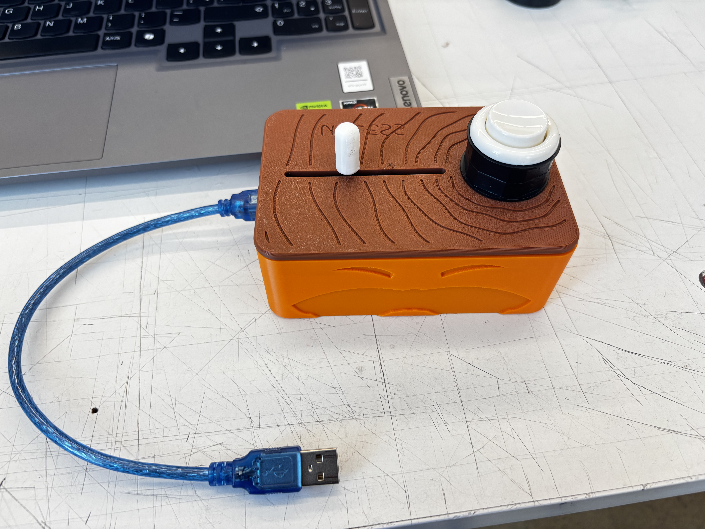
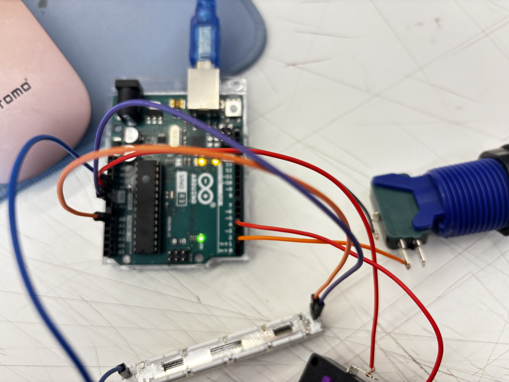
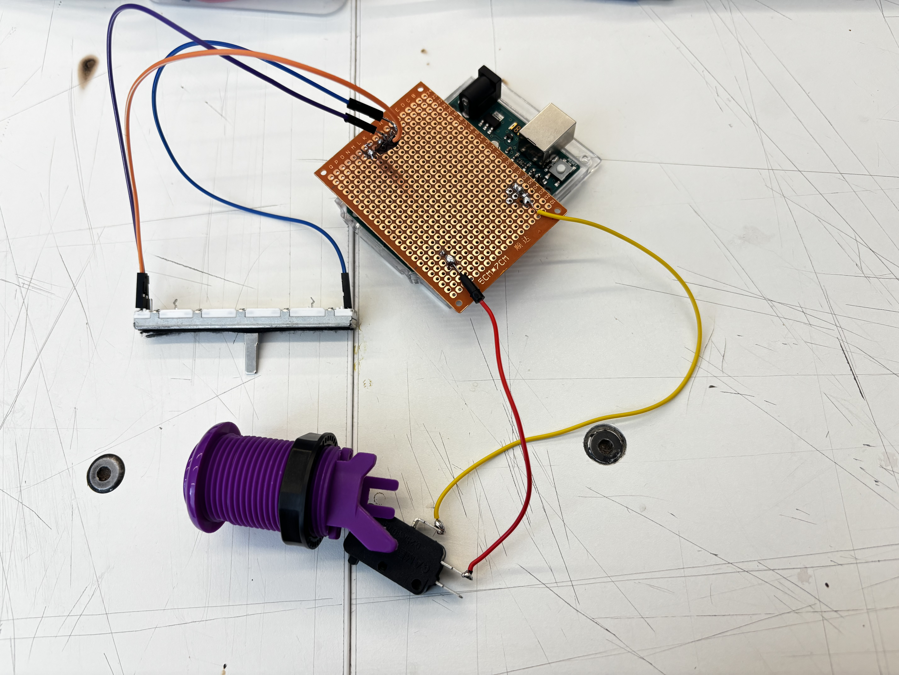
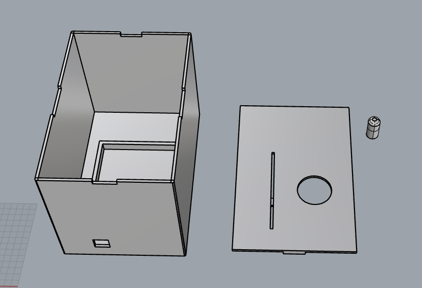
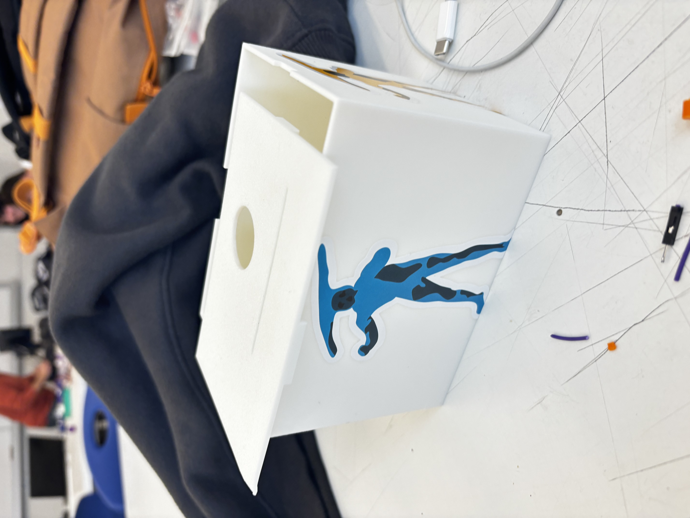

[README.md](https://github.com/user-attachments/files/34325295/README.md)
# 🌳 El Lorax · Un controlador físico para un videojuego

> *«Yo hablo por los árboles.»*

Este proyecto es un **videojuego del Lorax** que se juega en el computador, pero no con teclado ni mouse: se juega con un **controlador hecho a mano**, una cajita café y naranja con la cara del Lorax, construida con un Arduino, un botón arcade y un potenciómetro deslizable.

<p align="center">
  
</p>

---

## 🎮 ¿De qué se trata?

El Lorax corre por un bosque de Truffulas mientras las máquinas del Once-ler y el smog avanzan contra él. El jugador tiene que **saltar** los tocones, **pegarle** a las máquinas y al humo, y recoger semillas. Cada enemigo derrotado planta un arbolito, y a medida que el bosque crece, la niebla gris del cielo se va despejando.

Son dos partes que trabajan juntas:

| Parte | Qué es |
|---|---|
| **Interfaz (el juego)** | Una página web (`index.html`) con el Lorax saltando, que se abre en el computador. |
| **Controladora** | La cajita con el Arduino adentro, conectada por USB. Es lo que el jugador tiene en las manos. |

La página lee el Arduino directamente desde el navegador (Web Serial). **Los datos del Arduino no se muestran en pantalla**: el juego solo los usa por detrás.

---

## 🕹️ Cómo se juega

| Control en la caja | Pin | Qué hace en el juego |
|---|---|---|
| **Botón arcade** | Pin 2 | **Saltar.** Si lo pulsas otra vez en el aire, haces un **doble salto** más alto. |
| **Palanca deslizable** (potenciómetro) | A0 | **Golpear.** Un movimiento rápido de la palanca hace que el Lorax pegue. |

**Reglas del juego**

- 🪚 **Máquinas cortadoras:** pégales para destruirlas.
- ☁️ **Nubes de smog:** pégales o esquívalas.
- 🪵 **Tocones:** no se pueden golpear, hay que saltarlos.
- ✨ **Semillas de Truffula:** recógelas para sumar puntos.
- 🌱 Cada enemigo vencido planta un árbol, y con más árboles el cielo se aclara.
- Tienes **3 vidas** y el juego se acelera mientras avanzas.

**Para probar sin el Arduino** (teclado): `Espacio` / `↑` / `W` saltar · `G` o clic golpear · `M` silenciar la música.

---

## 🧰 Materiales

- Arduino UNO R3
- Placa perforada de 5 × 7 cm (hecha a medida como *shield* sobre el Arduino)
- Potenciómetro deslizable
- Botón arcade con microswitch
- Cables, estaño y soldador
- Cable USB
- Caja impresa en 3D (cuerpo naranja + tapa café)

---

## 🛠️ Mi desarrollo, paso a paso

### 1. El código del Arduino

Lo primero fue lograr que el Arduino «hablara» con el computador. El sketch [`probarsifunciona.ino`](probarsifunciona.ino) lee dos cosas cada 100 ms y las envía por el puerto serie a 9600 baudios:

- el **botón** en el pin 2, configurado con `INPUT_PULLUP` (no necesita resistencia externa: cuando se aprieta, el pin lee `LOW`);
- el **potenciómetro** en el pin analógico `A0` (valores de 0 a 1023).

Cada línea que envía se ve así:

```
Botón: PRESIONADO   |   Potenciómetro: 512
```

El juego lee esas líneas, detecta si dice `PRESIONADO` y toma el número del final.

### 2. Las conexiones

Primero armé todo con cables sueltos para comprobar que funcionaba. Es el primer montaje: el potenciómetro deslizable y el botón conectados directamente al Arduino.

<p align="center">
  
</p>

Esquema de conexión (según el código):

| Componente | Conexión |
|---|---|
| Botón | Un terminal al **pin 2** y el otro a **GND** |
| Potenciómetro deslizable | Un extremo a **5V**, el otro a **GND** y el cursor (pin central) a **A0** |

### 3. Soldar la placa

Para que no se soltara ningún cable, pasé el circuito a una **placa perforada** que va montada encima del Arduino. Soldé con **estaño** los cables del potenciómetro y del botón a la placa. Desde ahí salen los cables que van al deslizable y al botón de la caja.

<p align="center">
  
</p>

### 4. ❌ Intento 1: la caja que no funcionó

Antes de la caja final hice una primera versión. La diseñé en **Rhino** y la armé con piezas blancas encajadas, con un monito azul pegado a un costado.

<p align="center">
  
</p>

<p align="center">
  
</p>

**Por qué no funcionó:** las medidas no estaban bien.

- El **botón no pasaba** por el agujero de la tapa.
- El **cable USB tampoco entraba** por la abertura del costado.

Aprendí a medir los componentes reales (el botón con su tuerca y el conector USB) antes de dibujar los agujeros, y con eso rehice el diseño.

### 5. ✅ La caja final

La versión final es una caja de dos colores, **naranja** en el cuerpo y **café** en la tapa, como el Lorax y un tronco de Truffula:

- En la **tapa**, vetas de madera grabadas, una ranura por donde se desliza la palanca blanca y el agujero para el botón arcade.
- En el **cuerpo**, las cejas y el bigote del Lorax en relieve.
- El **cable USB** entra sin problema por el costado.

<p align="center">
  
</p>

---

## 🔜 Pendiente

- Cambiar la parte **negra** del botón (la base y la tuerca) por una **café**, para que combine con la tapa.

---

## ▶️ Cómo usarlo

1. Sube [`probarsifunciona.ino`](probarsifunciona.ino) al Arduino desde el IDE de Arduino.
2. **Cierra el Monitor Serie** del IDE (si queda abierto, bloquea el puerto).
3. Abre [`index.html`](index.html) en **Chrome o Edge** (Firefox y Safari no soportan Web Serial).
4. Pulsa **🔌 Conectar Arduino** y elige el puerto del Arduino.
5. Pulsa el botón de la caja para empezar. ¡A salvar el bosque!

---

## 📁 Contenido del repositorio

```
├── index.html                # El juego (se abre en el navegador)
├── probarsifunciona.ino      # Código del Arduino
├── cajita.3dm                # Modelo 3D de la caja (Rhino)
├── IMG_3637.jpeg             # Primer montaje con cables sueltos
├── IMG_3638.jpeg             # Placa soldada
├── IMG_3788.jpeg             # Caja final
├── intento1.png              # Intento 1: diseño en Rhino
├── intento1.2.jpeg           # Intento 1: caja armada
└── README.md
```
